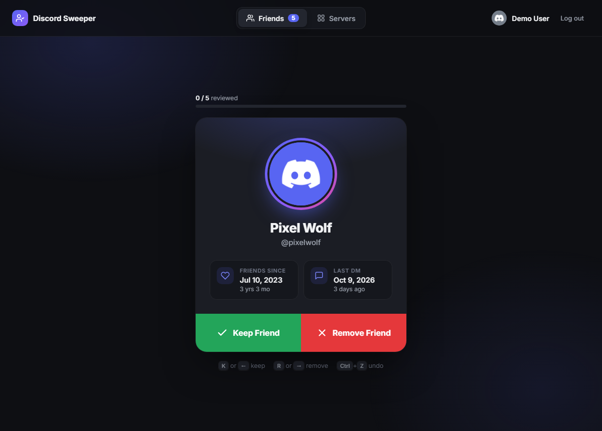
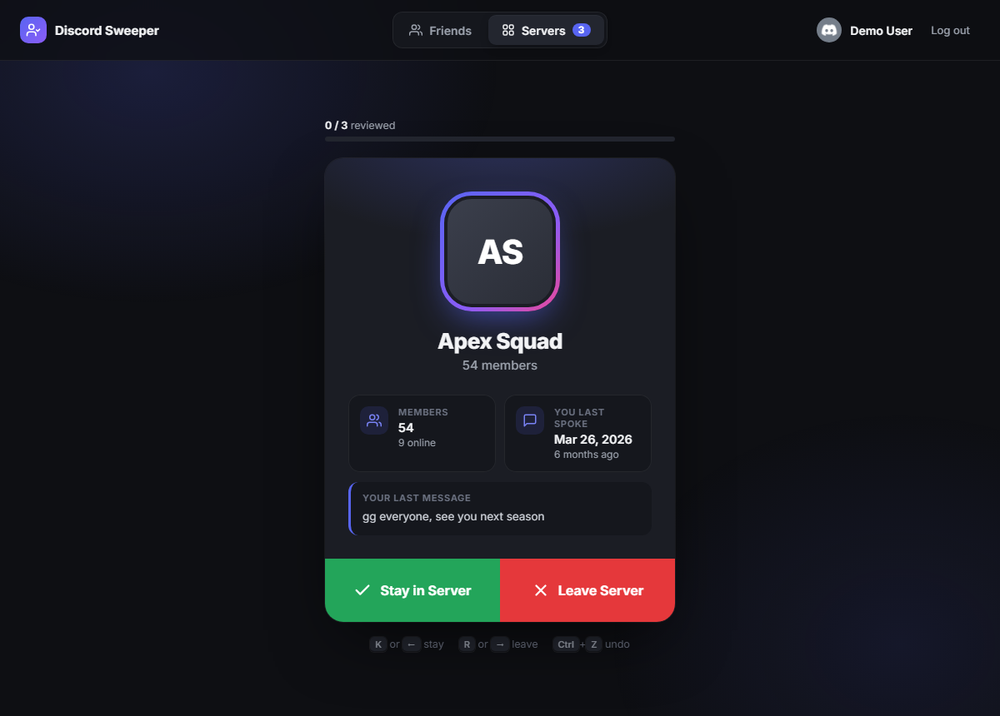
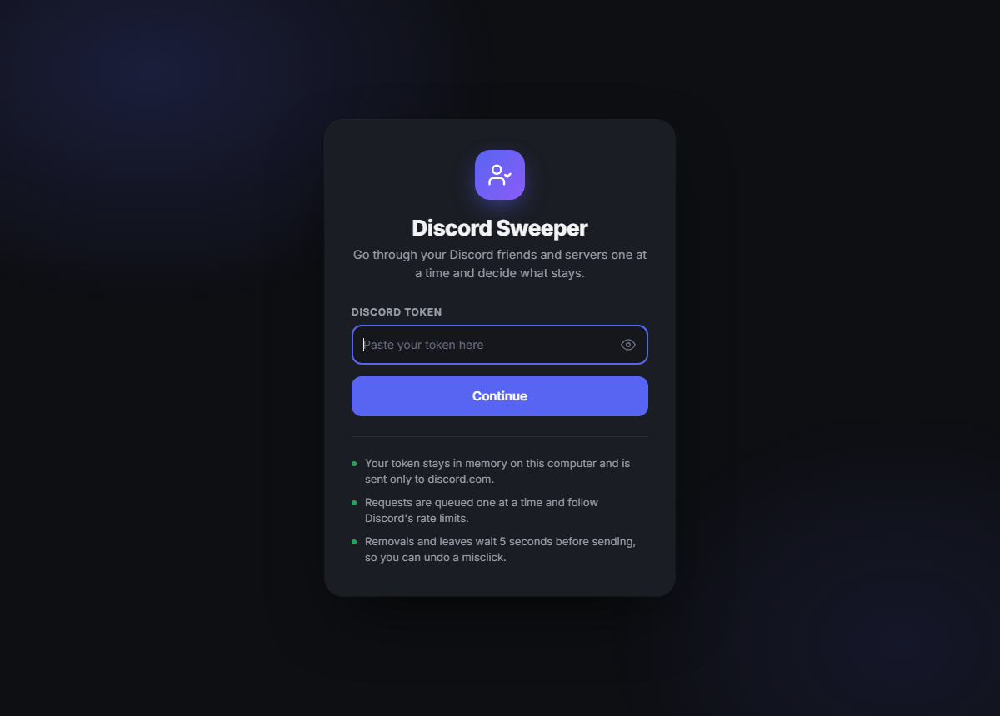

# Discord Sweeper

Go through your Discord friends and servers one at a time.

- **Friends tab:** choose **Keep Friend** or **Remove Friend**.
- **Servers tab:** choose **Stay in Server** or **Leave Server**.

## Screenshots

**Friends:** see when you became friends and when you last talked, then keep or remove.



**Servers:** see the member count and when you last spoke, with a preview of your last message, then stay or leave.



**Login:** paste your token to start. It stays on your computer.



## Setup

1. Install [Node.js](https://nodejs.org) 18 or newer. The LTS version is fine.
2. Download this project. Either click **Code → Download ZIP** on GitHub and extract it, or clone it:

   ```
   git clone https://github.com/Wraith0x10/discord-sweeper.git
   ```

There are no dependencies to install.

## Run it

On Windows, double-click `start.bat`. On any system, you can also run this in the project folder:

```
node server.js
```

Then open http://127.0.0.1:4783 and paste your Discord token.

## What it shows

**Friends**
- Display name, username, and profile picture
- The date you became friends and how long ago that was
- The date of the last message in your DM with them. "None found" means there is no open DM channel with that person.

**Servers**
- Server icon, name, member count, and online count
- When you last sent a message there, plus a preview of that message
- Servers you own are marked, and Leave is disabled for them. Discord requires you to transfer or delete a server you own.

The "last spoke" date uses Discord's message search. To stay well inside its strict limits, the app looks it up only for the server on screen and the next one. Lookups for servers you skip past are cancelled before they are sent. Results are cached until you restart the app. If Discord is still indexing a server, the card says so and checks again shortly.

## Controls

| Key | Action |
| --- | --- |
| `K` or `←` | Keep friend / stay in server |
| `R` or `→` | Remove friend / leave server |
| `Ctrl+Z` | Undo the last action |

- **Keep / Stay** saves that friend or server to `data/kept.json`, so it is skipped next time. Friends and servers are tracked separately. Use "Review kept again" on the finished screen to clear a tab's list.
- **Remove / Leave** waits 5 seconds before it is sent, so you can press Undo. After that it is permanent. Rejoining a server needs a new invite.

## Rate limits

- All Discord requests go through one queue, one request at a time.
- Reads are spaced at least about 1.1 seconds apart. Message searches are spaced 1.5 to 2.5 seconds apart. Removals and server leaves are spaced 3 to 5 seconds apart. All gaps have random jitter.
- Discord's rate-limit headers are tracked per route. A `429` response waits the time Discord asks for, then backs off further on each repeat.
- A rejected token (`401`) stops all traffic immediately, so the app never hammers Discord with a bad token.

## Privacy

- The server listens on `127.0.0.1` only, so other devices on your network cannot reach it.
- Your token is held in memory and sent only to `discord.com`. It is never written to disk, so you paste it again after restarting the app.

## Important

Using a user account token with a third-party tool is against Discord's Terms of Service. Careful rate limiting lowers the risk but cannot remove it. Use this at your own risk.
